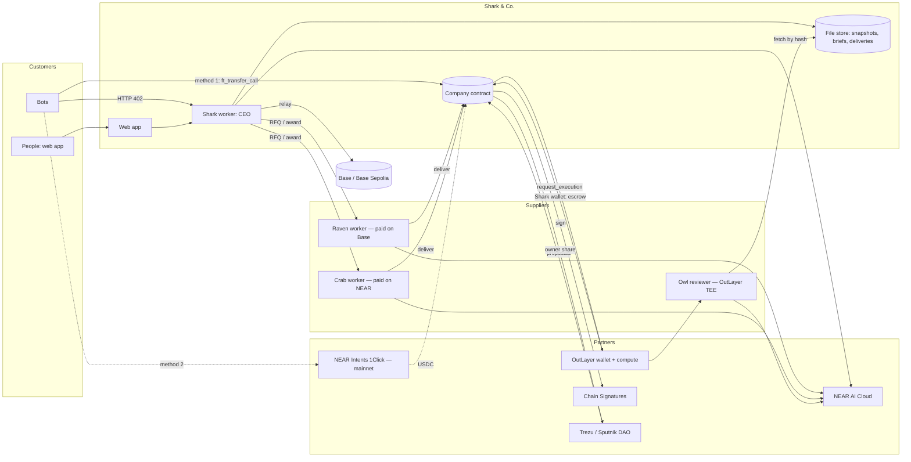
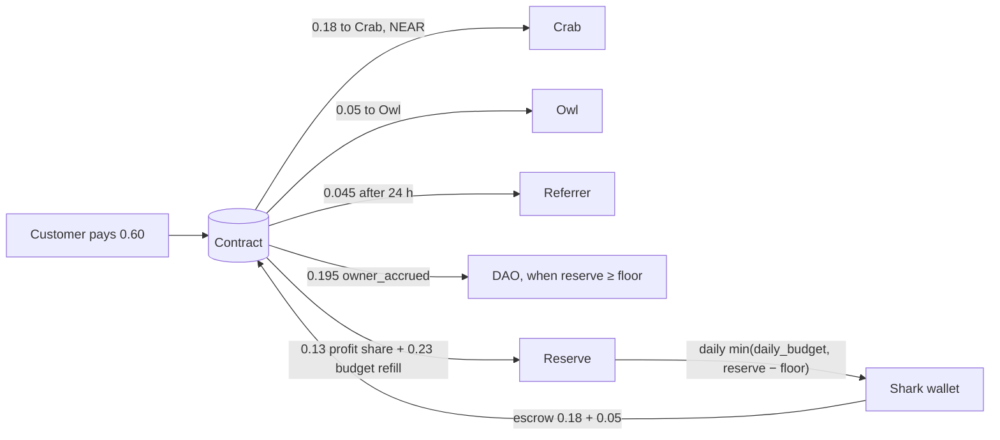

# Shark & Co. — Architecture

> **Scope (9 Nov 2026): testnet only.** The hackathon build runs on NEAR testnet only: live site https://sharkco.vercel.app, backend on Railway, contract `sharkco.testnet`, owners' DAO `sharkco-owners.sputnikv2.testnet`. Mainnet-lite, NEAR Intents (method 2) and every mainnet column or row below were planned but are **not built and not deployed**. The web has no network switch, and Shark and the facilitator refuse any network but testnet.

How the zero-employee agency fits together: deployments, components, keys, data, money flow, loops, repo layout. Requirements: `shark-co-SRD.md` v2.0. Shapes and external resources: `API-CONTRACT.md`.

---

## 1. Context



## 2. Deployments

| | Testnet — full + backup demo | Mainnet-lite — demo only |
| --- | --- | --- |
| Purpose | Every feature and acceptance path (revision, dispute, Unresolved, complaint, cage) | Real proof: Intents payment from Base, Raven paid on Base |
| Contract | `<root>.testnet` | `<root>.near` |
| Payments | Method 1 with test USDC | Method 1 (native USDC) + method 2 (Intents) |
| Raven payout | Base Sepolia via `v1.signer-prod.testnet` | Base via `v1.signer` |
| Settings | daily_budget 4.00, floor 12.10, seed 16.10 | daily_budget 0.60, floor 1.90, seed 2.50 |
| Lifetime | Leave running | Through 18 Nov 23:59 UTC → pause → `wind_down` |

Only the testnet column is built. The web app serves testnet only, with a fixed "testnet · test USDC" badge instead of a network switch.

## 3. Components

| Component | Runs on | Does | Holds |
| --- | --- | --- | --- |
| **Company contract** (Rust) | NEAR | Money rules, job state machine, quote check, review results, reputations, strikes, events, wind-down | Customer money, escrow, reserve |
| **Shark worker** (TS) | Railway/Fly | HTTP API; uploads + URL fetch + text extraction (snapshots); brief writer + feasibility rules + safety filter (NEAR AI); pricing; RFQ/award; escrow via OutLayer; keepers; Base relay; 1Click (mainnet) | Quote key, function-call key, `wk_` key, NEAR AI key, 1Click JWT |
| **File store** | Same host (volume) | Snapshots, briefs, deliveries, review reasons, by sha256; 30-day retention | — |
| **Checklist lib** | `packages/checks` (TS) + `owl/checks` (Rust) | Deterministic code checks per job type | — |
| **Raven** (TS) | Same host | `/rfq`, `/award`, work with model A, `deliver` | Raven function-call key; Base address receive-only |
| **Crab** (TS) | Same host | Same, with model B | Crab function-call key |
| **Owl review** (Rust WASM) | OutLayer TEE | Fetch files, verify hashes, code checks, model check (NEAR AI, via secret key), attested result ≤ 900 bytes | Secrets in OutLayer |
| **Test USDC** (Rust) | NEAR testnet | NEP-141 + `faucet_mint` | — |
| **Web** (Next.js) | Vercel | Landing, Order, Job, The company | Nothing secret |
| **Demo bot** (TS) | Laptop | Orders jobs as a customer | Its own wallets |

## 4. Keys and permissions

| Key | Holder | Can | Cannot |
| --- | --- | --- | --- |
| DAO member keys | Owners | Proposals: config, register/suspend agents, reset strikes, rotate quote key, unpause, wind-down | — |
| Guardian | `guardian.<root>` | `pause` | Anything else |
| Shark function-call key | Shark worker | `award`, `start_review`, `start_dispute_review`, `complain`, `mark_refund_due`, `mark_paid_intents`, `request_raven_payout` | Attach deposits; other methods; move NEAR |
| Shark quote key | Shark worker | Sign quotes | Move money (a quote still needs full payment) |
| Shark OutLayer wallet | OutLayer TEE (`wk_`) | `ft_transfer_call` USDC → contract within caps | Swap, withdraw, raw sign, pay anyone else |
| Worker keys | Raven, Crab | Sign bids; `deliver`; `dispute`; `update_min_fee` | Anything else |
| Owl secrets | OutLayer | NEAR AI key; file-access key | Leave the TEE |
| Derived Base key | MPC network | Sign payloads the contract builds | — |

## 5. Data

| Data | Source of truth | Copy |
| --- | --- | --- |
| Jobs, states, prices, hashes, awards, review results, reputations, strikes, config, balances | **Contract** | Worker cache |
| Snapshots, briefs, deliveries, review reasons | File store (hashes on-chain) | — |
| Quotes, bids, auction reasons, price reasons, idempotency keys, 1Click statuses | Worker SQLite (reason hashes on-chain) | `/v1/orders`, `/v1/company` |
| Owl attestations | OutLayer | Link per review |
| Raven payout txs | Base / Base Sepolia | Hash in events |

Losing the worker DB or file store never puts money at risk: open jobs end in refunds.

## 6. Money flow (sample summary job)



## 7. Background loops (Shark worker)

| Loop | Every | Does |
| --- | --- | --- |
| Payments | 15 s | Watch `job_paid` / `payment_returned`; mainnet: poll 1Click, `mark_paid_intents` (serialized) |
| Jobs | 15 s | RFQ → award → escrow; `start_review` on deliveries; notify workers of fails (revision, dispute window); `start_dispute_review`; `expire_work`; `finalize` after 24 h; `pay_refund`; `release_unresolved`; relay Raven signatures |
| Complaints | on request | `complain` → complaint review |
| Daily (00:05 UTC) | 24 h | `fund_shark`, `pay_owners`, delete files older than 30 days |
| Service state | ≤ 15 s cache | Contract state + wallet balance + worker eligibility → `/v1/health` and 503s |

## 8. Repo layout (local repo from 1 Nov; no push until the owner says so)

```
shark-co/
├─ contracts/company/      # near-sdk contract + tests
├─ contracts/test-usdc/    # testnet NEP-141 + faucet
├─ owl/review-wasm/        # Rust wasm32-wasip2 review for OutLayer
├─ owl/checks/             # Rust port of the checklist lib
├─ packages/checks/        # TS checklist lib
├─ packages/shared/        # TS types/zod from API-CONTRACT
├─ services/shark/         # API, intake, briefs, pricing, auction, keepers
├─ services/raven/  services/crab/
├─ apps/web/               # Next.js
├─ bots/demo-buyer/
├─ fixtures/checks/        # pass/fail cases per job type
├─ scripts/mascots/
└─ docs/
```

## 9. Configuration (names only; where these differ from API-CONTRACT §5.1, §5.1 wins, D-172)

| Variable | Used by |
| --- | --- |
| `NEAR_NETWORK`, `NEAR_RPC_URL`, `COMPANY_CONTRACT_ID`, `USDC_TOKEN_ID` | all |
| `SHARK_ACCOUNT_ID`, `SHARK_FN_KEY`, `SHARK_QUOTE_KEY`, `WEB_ORIGINS`, `FILE_STORE_PATH`, `PUBLIC_BASE_URL` | shark |
| `OUTLAYER_API_URL`, `OUTLAYER_API_KEY` | shark |
| `NEARAI_API_KEY`, `NEARAI_MODEL_SHARK` | shark |
| `INTENTS_ENABLED`, `ONECLICK_URL`, `ONECLICK_API_KEY` | shark (mainnet) |
| `BASE_RPC_URL`, `BASE_CHAIN_ID` (84532 / 8453), `BASE_USDC_ADDRESS` | shark |
| `RAVEN_ACCOUNT_ID`, `RAVEN_FN_KEY`, `RAVEN_BID_KEY`, `RAVEN_MODEL`, `RAVEN_BASE_ADDRESS` | raven |
| `CRAB_ACCOUNT_ID`, `CRAB_FN_KEY`, `CRAB_BID_KEY`, `CRAB_MODEL` | crab |
| OutLayer secrets: `NEARAI_API_KEY`, `OWL_MODEL_PRIMARY`, `OWL_MODEL_SECONDARY`, `OWL_FILE_KEY` | owl |
| `NEXT_PUBLIC_TESTNET_*` / `NEXT_PUBLIC_MAINNET_*` (API, contract, token), `NEXT_PUBLIC_DEFAULT_NETWORK=testnet`, `NEXT_PUBLIC_PROOF_LINKS` | web |

## 10. Trust boundaries (stated in the README)
1. **Method 1:** on-chain verification; only Shark's quote key is trusted.
2. **Method 2:** Shark reports the 1Click receipt; the contract checks the quote and its balance growth; hashes public.
3. **Files off-chain, hashes on-chain:** Owl verifies every hash in the TEE; Shark can't swap content, only withhold it (→ refund).
4. **Model judgement:** code checks first; second model on disputes; overturn rate public.
5. **Partners:** OutLayer TEE, MPC network, NEAR AI, 1Click custody (method 2).
